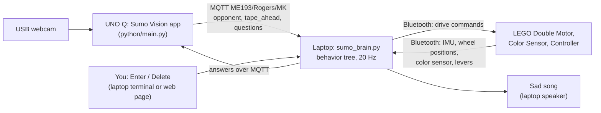

# Robot Sumo: "The Mirage" (ME 193, Project 5)

A sumo robot built from a LEGO Double Motor and an Arduino UNO Q with a webcam. Its behavior combines **autonomous reflexes**, **camera-based opponent detection that a human approves**, and a **teleop override**, organised as a **behavior tree** that runs on a laptop.

**Contents:** [1. The task](#1-the-task) · [2. The robot](#2-the-robot) · [3. How it works](#3-how-it-works) · [4. Running it](#4-running-it) · [5. Calibration](#5-calibration-measured-on-this-robot) · [6. Tools and tests](#6-tools-and-tests) · [7. What was tested](#7-what-was-tested-on-the-real-robot) · [8. Limitations](#8-known-limitations) · [9. Repository layout](#9-repository-layout) · [10. Changes since the first version](#10-changes-since-the-first-version) · [11. Troubleshooting](#11-troubleshooting)

---

## 1. The task

The ring is a circle of blue tape, and the first robot pushed fully out of it loses. When our robot is out, it must stop and play a sad song. The robot is built from LEGO with the UNO Q as a sensor (course limits as we understood them: at most 1 kg, fits in a 30 cm cube).

The assignment asked for one algorithm family (behavior trees, decision trees, KNN or K-means), at least two sensors, at least one autonomous and one teleoperated behavior, and meaningful shared control.

| Requirement | How this project meets it |
|---|---|
| Algorithm family | **Behavior tree** (`sumo_brain.py`), evaluated 20 times a second |
| At least two sensors | LEGO color sensor, IMU (accelerometer), webcam, wheel position counters, controller levers |
| Autonomous behavior | Edge escape, back-off, push counter-attack, tip-over stop, "are we out?" detection |
| Teleoperated behavior | LEGO Controller: tank-style levers drive the robot |
| Meaningful shared control | The camera *proposes* ("Opponent?", "We're OUT?"), the human *approves* with Enter / Delete; the controller *overrides* everything; safety reflexes need no approval |
| Stop and sad song when out | The laptop plays it when the out decision is approved |

**Strategy ("The Mirage").** The robot is ringed by an apron of white LEGO track taped blue. The idea is that an opponent whose color sensor looks for the blue ring edge reads our apron as the edge and backs away. The apron is on the robot, but its effect on opponents has not been tested (see [7](#7-what-was-tested-on-the-real-robot)).

## 2. The robot

| Part | Where | What it does |
|---|---|---|
| LEGO Double Motor | Under the chassis, facing the **back** of the robot (`MOTOR_BACKWARD = True`) | Drives both sides (tank steering). Its built-in IMU gives the accelerometer used for push and tip detection. Its wheel position counters give the direction the robot is rolling. |
| LEGO Color Sensor | At the **back**, pointing down | Is the back of the robot over the blue tape? |
| LEGO Controller | In the driver's hands | Teleop override: left lever drives the left wheels, right lever the right wheels |
| Arduino UNO Q + Logitech USB webcam | On top; the camera is on an arm at the front | Runs the *Sumo Vision* app: finds the opponent and the tape ahead, shows them on a web page, and sends numbers to the laptop. The UNO Q **never drives**. Its LED matrix shows the opponent's position. |
| Laptop | Off the robot | Runs the behavior tree over Bluetooth, plays the sad song |
| 3D-printed chassis, blue-taped apron | | |

## 3. How it works

### Architecture



MQTT goes through the public broker `test.mosquitto.org`, so the laptop and the board only need internet access with port 1883 open (they do not have to be on the same network). The camera's web page (`http://<board-ip>:7000`) needs more: the laptop must be able to reach the board directly, which some networks (our campus WiFi, for one) do not allow. Everything the page can do can also be done from the laptop terminal.

### The behavior tree

Checked top to bottom, 20 times a second. The first branch that applies wins. The label is what the terminal status line shows.

| # | Condition | Action (status label) |
|---|---|---|
| 1 | The app says we're out | Stop, play the sad song, quit (`OUT - sad song`) |
| 2 | The back crossed the tape **and** the camera sees tape ahead | Stop on its own and ask the app (`OUT? stopped, ask app`) |
| 3 | A controller lever moved | The driver drives (`DRIVER OVERRIDE`) |
| 4 | Tipped over (IMU) | Stop until it is back on its wheels (`TIPPED OVER - stop`) |
| 5 | Back on tape **and** the wheels were rolling forward toward a line the camera saw | We drove over the line: reverse (`back edge: BACK OFF`) |
| 6 | Back on tape | Full power forward, then turn back into the ring (`back edge: forward`) |
| 7 | In the middle of a maneuver | Keep doing it (`edge maneuver`) |
| 8 | Pushed from the front (IMU) | Full power forward, counteracting it (`IMU PUSH! pushing back`) |
| 9 | The app said charge | Charge straight ahead (`CHARGE (app)`) |
| 10 | Otherwise | Sit still (`waiting (still)`) |

The same tree is written out at the top of `sumo_brain.py`.

### Shared control

* **The robot never charges on its own.** The camera proposes "Opponent?"; you press **Enter** to approve (it charges while the opponent stays in view) or **Delete** to reject. Delete with no question open stops a charge.
* **The controller is an absolute override.** Touch either lever and you drive; let go of both and the tree takes over again.
* **Safety reflexes need no approval:** the edge escape, the push counter-attack and the tip-over stop run by themselves.

### "Are we out?" (sensor fusion)

The floor is the same inside and outside the ring, so only the tape tells the difference. When the robot is shoved out backward, the **back color sensor** crosses the tape first (blue, then floor). If the **front camera** then sees tape ahead, the tape has been crossed by the whole robot. The robot stops by itself, the app asks "We're OUT?", and **Enter** plays the sad song (**Delete** means "false alarm, keep wrestling").

### The edge reflexes (the back sensor touches the tape)

* **Normally** the robot is being pushed out backward, so it drives forward at full power, then turns back into the ring.
* **If it drove over the line** (for example, charging a box out of the ring), forward would take it further out, so it **backs off** instead. The decision uses two signals together: the wheels were rolling the robot *forward*, and the camera had *seen the line ahead* in the last 3 seconds. The camera check matters: the wheel counters follow the wheels, not the floor, so a robot dragged backward with its wheels spinning forward would otherwise be told to reverse. The decision is made once, when the back first touches the tape. A second contact within `BACK_OFF_RECOVER` seconds (the reverse can cross the line again) keeps the back-off going.
* **After any edge event the charge is cancelled** and you approve a new one. The escape moves and turns the robot, so the old approval is stale.

Each of these has a switch at the top of `sumo_brain.py` (`OVERSHOOT_BACKOFF`, `OVERSHOOT_NEEDS_LINE`, `EDGE_CANCELS_CHARGE`).

### The vision app (`sumo-vision/`)

* **Floor model.** For its first 20 frames (robot in the ring, empty floor in view) it learns the floor's colour **for every row of the image**, because the floor looks different near and far. Learning ignores blue tape. An opponent is a blob of pixels that differ from the floor at their own row, after the camera's exposure and white-balance drift is measured on the floor and removed.
* **Tape.** `tape_ahead` is the fraction of the bottom strip of the picture that is blue. **Click on the tape** in the web page to teach the app its real colour under your lights. It remembers it in `tape_calibration.json` (next to `main.py`, on the board), and the page says on start-up whether it was loaded. That file belongs to one board and one set of lights, so it is not committed (the app's `.gitignore` excludes it).
* **Own apron.** `SELF_MASK_BOTTOM` ignores the bottom of the picture if the robot's own apron ever shows there.
* **Questions.** An opponent must be seen `OPP_CONFIRM` frames in a row, and be at least `MIN_OPP_AREA` of the ground area, before the app asks. Blobs below that size are drawn in yellow ("too small").
* **Messages** go out about 10 times a second as JSON on `ME193/Rogers/MK`; the full format is in the header of `sumo-vision/python/main.py` and `sumo_brain.py`.

## 4. Running it

### Prerequisites

* The course repository, with `lelib.py` at its root and `MQTT/mqttlib.py` (the brain imports both). If your clone is a *sparse checkout* that only has this folder, run `git sparse-checkout add MQTT`.
* Python (we used 3.12, on Windows) with `legoeducation`, `bleak` and `paho-mqtt`. They are in the course `requirements.txt`; on Windows skip its macOS-only `pyobjc-*` lines. The brain itself needs nothing else (no OpenCV or NumPy). Bluetooth on.
* An Arduino UNO Q running Arduino App Lab, with a USB webcam.

### Start the camera app (UNO Q)

Open the `sumo-vision` folder as an app in Arduino App Lab and run it with the **robot sitting in the ring, looking at empty floor** (that is when it learns the floor). Open `http://<board-ip>:7000`, then **click on the blue tape** once.

### Start the brain (laptop)

From this folder:

```
python sumo_brain.py --speed 0.5          # the real thing (Windows; use le-venv/bin/python on macOS)
python sumo_brain.py --readings           # print the color sensor readings (tuning)
python sumo_brain.py --imu                # print accelerometer readings (tuning)
python sumo_brain.py --no-lego            # run the tree without the LEGO parts
python sumo_backup.py                     # backup brain: no UNO Q, no camera, keyboard only
```

Keep the robot **still** while it connects, because the IMU learns its resting value. Run it in a normal terminal so the keys work. Keys: **Enter** = yes / charge, **Delete** (or Backspace) = no / stop charge, **o** = we're out, **Ctrl+C** = quit. After an "out" the app stops asking about opponents until you restart it.

Use `--speed 0.3` for a first run with the wheels off the ground. The default speed scale is 0.7.

## 5. Calibration (measured on this robot)

Some values depend on how the robot is built or on the floor and light. They were **measured** with the tools below, not guessed.

| Setting | Value | Where | How it was measured |
|---|---|---|---|
| `IMU_AXIS` | `accelerometerX` | `sumo_brain.py` | `imu_check.py`: the axis that jumps most when the robot is shoved |
| `IMU_FORWARD_SIGN` | `-1` | `sumo_brain.py` | `imu_check.py`: forward reads as a *down* jump because the Double Motor faces backward |
| `PUSH_ACCEL` | `300` | `sumo_brain.py` | `imu_check.py`: a sharp backward slap with the wheels held read about -495, a free shove about -395 |
| `TIP_ANGLE` | `45` degrees | `sumo_brain.py` | `imu_check.py`: tilting reached 51 to 60 degrees |
| `WHEEL_FORWARD_SIGNS` | `(1, -1)` | `sumo_brain.py` | `wheel_check.py`: driving forward makes wheel 0 count up and wheel 1 count down (the motors are mirrored) |
| `OVERSHOOT_TRAVEL` | `90` wheel degrees | `sumo_brain.py` | `wheel_check.py`: one second at 40% speed turned the wheels about 280 degrees |
| `TAPE_COLOR` | `Blue` | `sumo_brain.py` | `sumo_brain.py --readings` |
| `MIN_OPP_AREA` | **`0.04`** (the original default was `0.02`) | `sumo-vision/python/main.py` | `vision_check.py --guided`: a thin false "opponent" on a glossy wood floor read 0.02, real opponents 0.10 and up |
| Tape colour | learned by clicking | on the board | the web page |

`IMU_FORWARD_SIGN` and `WHEEL_FORWARD_SIGNS` depend on how the Double Motor is mounted: re-run `imu_check.py` and `wheel_check.py` if it ever changes. `MIN_OPP_AREA` depends on the floor: re-run `vision_check.py --guided` on the game floor.

## 6. Tools and tests

Run these from this folder with the brain's own settings. Tools marked **moves the robot** make it drive, so put it on a box with the wheels off the ground.

| Tool | What it does |
|---|---|
| `imu_check.py` | Guided, six steps (still, tap, shove forward, shove backward, shove backward with the wheels held, tilt). Prints PASS or FAIL and the exact line of `sumo_brain.py` to change. `--held-only` runs only the held-wheel shove. |
| `wheel_check.py` | **Moves the robot.** Drives forward then backward and works out the per-wheel signs. |
| `imu_probe.py` | Diagnostic: counts how many IMU and wheel readings arrive per second. |
| `motor_test.py` | **Moves the robot.** Drives each move the tree can make so you can check direction. |
| `sumo_vision_tests/` | Tests for the camera app (see below). |

### Camera app tests (`sumo_vision_tests/`)

| Command (run inside that folder) | What it tells you |
|---|---|
| `python vision_check.py --watch 15 --brain ../sumo_brain.py` | Message rate, gaps, anything strange on the topic |
| `python vision_check.py --guided --brain ../sumo_brain.py` | Five scenarios (empty ring, tape, opponent, left, right), PASS or FAIL, and what to change |
| `python vision_latency_test.py --brain ../sumo_brain.py` | How long a blue edge takes to become a reading on the laptop |
| `python check_detector.py ../sumo-vision/python/main.py` | A stress test of the detector on synthetic pictures: run it after any change to the detection code |
| `python test_tools.py` | The tools' own 20 tests (16 run anywhere; 4 need Mosquitto installed and are skipped without it) |

The detector stress test uses **synthetic pictures**, so it is a regression gate, not a measurement of the real camera. See that folder's `README.md` for details.

## 7. What was tested on the real robot

Tested, on the real robot, mostly at `--speed 0.5` (some at 0.3 and 0.7):

* The charge / stop flow with the approval question, and the vision check (all five scenarios pass on our test floor).
* The back-edge escape: pushing the robot backward over the tape gives `back edge: forward`.
* The "out?" question: Delete returns to `waiting`; Enter plays the sad song and ends the program.
* The controller override, the tip-over stop, and the push counter-attack.
* Charging a box over a taped line: the robot backs off and ends up inside. Pulling the *charging* robot backward over a line gives the forward escape, not the back-off. The charge is cancelled after both, and a late charge message is ignored.

**Not tested yet:**

* The edge tests at `--speed 0.7`.
* A real opponent robot (so far: a box, and a hand).
* A full match, and the game floor and lighting.
* Whether the blue apron actually fools opponents.

## 8. Known limitations

* **Nothing guards the front edge while charging.** The only color sensor is at the back, so a charge that carries the robot out is only caught after the back crosses the line. A color sensor at the front is the real fix.
* **The reaction is bounded by a human** for charging, and, for the back-off, by the camera's short range: it only judges the nearest strip of floor in front of the robot.
* **`MIN_OPP_AREA` trades range for false alarms.** At 0.04 a small or distant opponent is ignored (shown in yellow).
* **The wheel counters measure the wheels, not the floor.** A robot dragged backward with its wheels spinning forward reads "rolling forward"; the camera check covers this, but it is untested with a real opponent. For 1 second after a back-off, an opponent pushing the robot over a line would also be answered with a reverse (`BACK_OFF_RECOVER`).
* **The IMU thresholds were set with hand shoves.** A real opponent's impact may be harder or softer.
* **MQTT uses a public broker** (`test.mosquitto.org`): it needs internet, and a different broker needs a change in both `sumo_brain.py` (`mqttlib`) and the app (`BROKER`).
* `sumo_backup.py` keeps the **original** edge reflex: it has no back-off logic.
* **Platforms.** Everything on the robot was run on Windows. The macOS/Linux code paths (keyboard through `termios`, sound through `afplay`/`paplay`) are the original ones and were only exercised in simulation when the Windows paths were added.

## 9. Repository layout

```
Project 5 - Robot Sumo/
├── README.md                this file
├── sumo_brain.py            the laptop brain: behavior tree, sensor fusion, shared control
├── sumo_backup.py           backup brain without the UNO Q (keyboard only)
├── motor_test.py            drive each move the tree can make (moves the robot)
├── imu_check.py             guided IMU check
├── wheel_check.py           guided wheel-direction check (moves the robot)
├── imu_probe.py             IMU / wheel reading-rate diagnostic
├── sumo-vision/             the UNO Q app (open in Arduino App Lab)
│   ├── app.yaml
│   ├── python/main.py       camera, detector, MQTT, web page backend
│   ├── assets/              web page: index.html, app.js, style.css
│   └── sketch/sketch.ino    LED matrix (shows the opponent's position)
└── sumo_vision_tests/       tests for the camera app
```

## 10. Changes since the first version

For teammates: what is different from the first working version.

* **`sumo_brain.py`:** Windows keyboard and sad song; the MQTT client no longer depends on what `mqttlib.connect()` returns; the `--imu` display was reading a stale sensor object (fixed); per-wheel direction tracking (`wheel_travel`, `forward_travel`); the back-off, the charge cancel and the camera check (with the switches above); measured IMU and wheel signs; the header docstring updated.
* **`motor_test.py`:** it asked for constants that no longer exist; fixed, and it now includes the back-off move.
* **`sumo-vision/python/main.py`:** per-row floor model with drift removal; click-to-learn tape colour (saved, and refused if the click is not blue); learning ignores tape in view; own-apron mask; the opponent must be confirmed over several frames; non-blocking MQTT connect; the loop now holds about 10 messages a second; the web page reports whether the saved tape colour loaded.
* **`sumo-vision/assets/`:** the click-to-learn handler and a line showing the apron mask.
* **`sumo-vision/.gitignore`:** also ignores `tape_calibration.json`.
* **New:** `imu_check.py`, `wheel_check.py`, `imu_probe.py`, `sumo_vision_tests/`.

## 11. Troubleshooting

| Symptom | Cause and fix |
|---|---|
| `No module named 'mqttlib'` | The `MQTT/` folder is missing from a sparse checkout: `git sparse-checkout add MQTT` |
| `pip install -r requirements.txt` fails on an `opencv-python` conflict | The course file pins both `opencv-python` and `opencv-contrib-python`. The brain does not need either: install just `legoeducation bleak paho-mqtt` |
| Keys do nothing | Run in a normal terminal (not an editor's Run button) |
| Robot does not move, or moves the wrong way | Run `motor_test.py` and check `MOTOR_BACKWARD` |
| `IMU PUSH!` never fires, or fires at nothing | Re-run `imu_check.py`; check `IMU_FORWARD_SIGN` and `PUSH_ACCEL` |
| The back-off drives the wrong way | Re-run `wheel_check.py`; or set `OVERSHOOT_BACKOFF = False` |
| The app keeps asking "Opponent?" about nothing | Press **Relearn floor** with the robot in the ring on empty floor; run `vision_check.py --guided` and follow its advice about `MIN_OPP_AREA` |
| The app stops asking about opponents | It is in its "out" state: restart it |
| Web page unreachable | The laptop cannot reach the board on this network; answer in the laptop terminal instead (it works over MQTT) |
